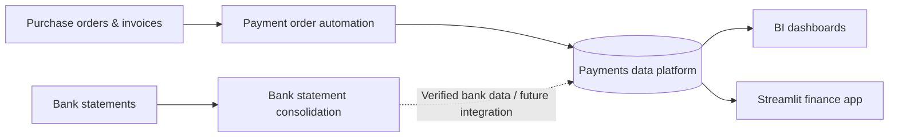

# Lautaro Bermúdez

**Finance Automation & Data Solutions**  
Financial Operations · Python · SQL/PostgreSQL · Business Intelligence · AI-assisted Automation

I work at the intersection of **finance operations, data, and software**. My background is in administration and treasury—accounts payable, cash flow, bank statements, and financial reporting. I identify operational bottlenecks, define the business rules, and build tools that make financial information more reliable and useful.

At work, I began by automating payment workflows so routine tasks could be supervised rather than processed manually. That grew into a broader initiative: centralizing finance data, developing reporting capabilities that had not previously existed, and building internal tools for analysis. These projects started from **real operational needs**, not tutorial exercises.

## Finance automation portfolio

Five connected projects illustrate the journey from **source documents → controlled workflows → reliable data → financial analysis and applications**.

> **Portfolio scope:** These are public, sanitized or rebuilt versions of solutions informed by work experience. They use synthetic data and exclude confidential company information. The repositories explain their own scope and limitations. The diagram shows how the tools relate conceptually; the dotted connection is **not** an implemented production integration.

### 1. Core platform — [Payments Data Platform](https://github.com/lautarobermudez/payments-data-platform)
**Problem:** Payment orders, suppliers, and treasury information were fragmented across files, making consistent financial reporting difficult.

**Solution:** A PostgreSQL relational model and an incremental Python ETL pipeline: dry-run by default, content hashes to load only new or changed rows, a quarantine for invalid rows, and source-to-database reconciliation that rolls everything back on mismatch. A trigger-based audit trail records every change (old and new row, who, which run), every execution is logged, and a read-only **FastAPI** REST API exposes orders, suppliers, payables aging and the run log, with "read-only, no bank data" enforced by the database role. The public rebuild includes synthetic datasets, SQL data-quality rules, BI-ready views, `make demo`, and CI.

**Skills:** PostgreSQL · Python · ETL · Data modeling · Audit trail · REST API (FastAPI) · Docker · Data quality

### 2. Operational automation — [Purchase Order Automation](https://github.com/lautarobermudez/purchase-order-automation)
**Problem:** Turning incoming purchase orders, invoices, and payment requests into payment orders required repetitive administrative work.

**Solution:** Python-based payment-order generation and mailbox review, plus AI-assisted invoice extraction where needed. Validation rules, duplicate detection, dry-run defaults, and human approval protect the workflow.

**Skills:** Python · Accounts payable · Document processing · Claude Code · Controls and validation

### 3. Bank data — [Bank Statement Consolidation](https://github.com/lautarobermudez/bank-statement-consolidation)
**Problem:** Preparing a fiscal-year report required consolidating bank statements from multiple accounts, banks, periods, and file formats, often with overlapping downloads.

**Solution:** A reproducible pipeline to inventory, normalize, deduplicate, consolidate, and verify transactions and running balances. The repository includes a Claude Code skill, sample data generator, tests, and example Excel outputs.

**Skills:** Python · Financial reconciliation · Excel · Data normalization · Traceability

### 4. Financial reporting — [Payments BI Dashboards](https://github.com/lautarobermudez/payments-bi-dashboards)
**Problem:** Finance teams need visibility into spending, suppliers, payables, due dates, and cost centers—not just raw transactions.

**Solution:** Power BI and Tableau dashboards built on the data platform's BI views, with documented measures, visuals, screenshots, and synthetic data.

**Skills:** Power BI · DAX · Tableau · SQL · Financial KPIs

### 5. Internal data tools — [Payments Streamlit App](https://github.com/lautarobermudez/payments-streamlit-app)
**Problem:** Operational users need a simple way to explore payment orders, supplier balances, and upcoming or overdue obligations.

**Solution:** A read-only Streamlit application backed by PostgreSQL views, with separate query and calculation layers and tests comparing displayed KPIs with SQL.

**Skills:** Python · Streamlit · PostgreSQL · Data applications · Testing

## How I work

- **Start with the business problem.** Understand the financial process, controls, exceptions, and the information decision-makers need.
- **Make data verifiable.** Prefer repeatable ETL, reconciliation, explicit validation, and traceable outputs over manual fixes.
- **Keep humans in control.** Financial workflows should expose uncertain inputs and require review before consequential actions.
- **Use AI transparently.** I use Claude Code and other AI tools to accelerate development. I define requirements and business rules, review results, test behavior, and document limitations; the individual repositories describe the extent of assistance.

## Other work

Digital media automation: [NFL Content Automation](https://github.com/lautarobermudez/nfl-content-automation) · [Tweets No Huddle](https://github.com/lautarobermudez/tweets-nohuddle).

## Tools & background

**Finance:** Accounts payable · Treasury operations · Cash flow · Bank reconciliations · Financial reporting  
**Data & development:** Python · SQL · PostgreSQL · Supabase · ETL · FastAPI · Git/GitHub  
**Analytics:** Power BI · DAX · Tableau · Advanced Excel  
**AI & automation:** Claude Code · Skills/agents · MCP  
**Education:** B.A. in International Relations, Universidad Nacional de San Martín  
**Languages:** Spanish (native) · English (B2)

## Opportunities & contact

I'm interested in **Finance Automation, Finance Systems, Financial Data Analysis, Business Analysis, and Finance Operations** roles where business knowledge and technical execution meet.

[LinkedIn](https://www.linkedin.com/in/lautaro-bermudez-458b83a3/) · [Explore my repositories](https://github.com/lautarobermudez?tab=repositories)
